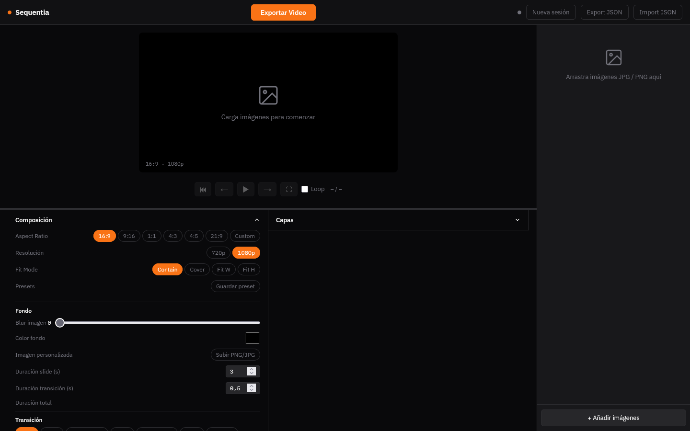
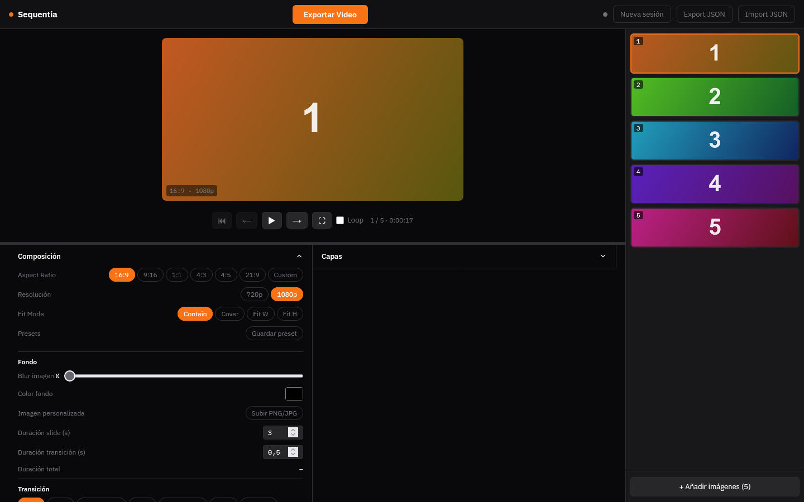
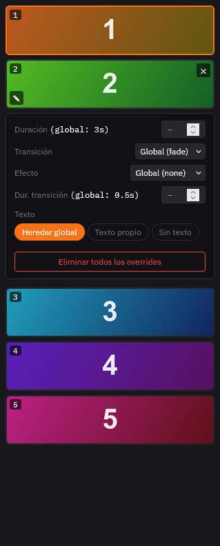

# Getting started

Open https://memoriainfinita.github.io/sequentia/ and use it in **Firefox**: the export is verified there. If you open `index.html` from a file, Chrome blocks the module workers the export needs, so it fails.

## Add images

Drop JPG or PNG images on the page, or press **+ Añadir imágenes**. Other formats show an error and are skipped. The slides appear in a column on the right, in the order they came in.

- Drag a slide up or down to reorder it; the × on a slide removes it
- A red **!** on a slide means the image is smaller than the video resolution you chose; hover it to see both sizes. It will be enlarged, and may look soft

## Preview

The controls under the preview go to the start (`R`), back and forward (`←` and `→`), play and pause (space), full screen (`F`) and loop (`L`). The counter shows the slide and the total length.

## Composition

The **Composición** panel sets how the video is built.

- **Aspect Ratio** 16:9, 9:16, 1:1, 4:3, 4:5, 21:9 or Custom; **Resolución** 720p or 1080p. With Custom you can save the size as a preset (**Guardar preset**)
- **Fit Mode**: Contain shows the whole image, Cover fills the frame and crops, Fit W and Fit H fit the width or the height
- **Fondo**: what shows around an image that does not fill the frame: a blurred copy of the image (**Blur imagen**), a colour, or an image of your own
- **Duración slide (s)** and **Duración transición (s)**; the total length appears under them

## Transitions and effects

- **Transición**: Fade, Slide, Zoom Punch, Wipe, Cross-Zoom, Flash, or Random, which draws from all of them. Slide and Wipe have four directions, Cross-Zoom a speed slider and Flash a colour
- **Efecto** is a movement on each image: none, zoom in or out, pan in four directions, Ken Burns and its reverse, or Random

## One slide different from the rest

The pencil on a slide opens its own settings: duration, transition, effect and transition duration, and whether it has the global text, its own text or none. A slide with its own settings shows a mark. **Eliminar todos los overrides** puts it back to the global ones.

## Export

Press **Exportar Video**. The video is encoded in the browser and downloaded as `sequentia.mp4`. Nothing is uploaded.

Next: [Layers and audio](layers.md).
